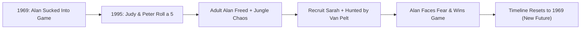

# Jumanji (1995) — Cool Or Nostalgia Cheat Sheet

> *"Roll the dice and unleash the excitement!"*

---

## 1. 30-Second Intro Synopsis (Ch. 1–2)
In 1969, 12-year-old Alan Parrish unearths a mysterious, drum-beating wooden board game called **Jumanji** and plays it with his friend Sarah Whittle—only to get sucked straight into the game's lethal jungle until someone rolls a 5 or 8. **26 years later** (1995), orphaned siblings Judy (Kirsten Dunst) and Peter (Bradley Pierce) move into the abandoned Parrish mansion, find the game in the attic, and roll a 5—releasing an adult, jungle-hardened Alan (Robin Williams) along with lions, stampedes, monsoons, giant mosquitoes, and a relentless big-game hunter named Van Pelt. To undo the chaos destroying their town, Alan must track down a traumatized adult Sarah (Bonnie Hunt) and finish the game they started in 1969.

---

## 2. The Case for COOL (What Holds Up — Ch. 3)
- **Genuinely Terrifying PG Stakes:** For a 1995 family adventure movie, *Jumanji* does **not** pull punches. Kids get swallowed by quicksand floors, chased by venomous plants, hunted with a real-world automatic shotgun, and watch a 12-year-old boy lose 26 years of his life. That dark edge is why it still hits way harder than sanitized modern family movies.
- **Robin Williams's Vulnerable, Grounded Performance:** Instead of doing 100 minutes of manic Genie bits, Williams plays Alan as a genuinely traumatized 12-year-old boy trapped inside a 38-year-old man's body—scared of his dad, bewildered by the modern world, and fiercely protective of the kids.
- **Practical Animatronics by ADI Still Rock:** While some early CGI looks rough, **Amalgamated Dynamics, Inc. (ADI)** built physical animatronics and puppets for the lion close-ups, giant mosquitoes, carnivorous vines, and the crocodile—giving the chaos real, tactile weight.
- **Kirsten Dunst & Bonnie Hunt Steal Scenes:** A 13-year-old Kirsten Dunst brings remarkable emotional poise as a grieving older sister who lies as a defense mechanism, and Bonnie Hunt's frazzled, therapy-scarred Sarah is hilarious and heartbreaking.
- **Joe Johnston's Relentless Adventure Pacing:** Fresh off *The Rocketeer* and *Honey, I Shrunk the Kids* (and later *Captain America: The First Avenger*), Johnston keeps the escalating disasters moving like a classic Spielbergian thrill ride, backed by a lush **James Horner** score.

---

## 3. Story Arc Deep-Dive: Loopholes, Logical Fallacies & What Actually Works
*Dedicated breakdown of the time-travel paradoxes, board-game logic gaps, and the surprisingly brilliant psychological storytelling underneath.*

### Logical Fallacies & Story Loopholes (The Nitpicks)
1. **The 1969 Timeline Reset Erases Judy & Peter (The Darkest Happy Ending Ever)** *(Time-Travel Paradox)*
   - **The Issue:** When Alan yells "Jumanji!", time rewinds 26 years to 1969. Alan and Sarah retain *all* their memories of 1995—meaning they grow up as traumatized adults inside kids' bodies, invest/plan a new life, and prevent Judy & Peter's parents from dying in a ski trip. **Wait a second:** That means the *original* Judy and Peter—the kids who bonded with Alan and saved his life—were effectively erased from existence and replaced by alternate-timeline versions who have **no memory of Alan at all**!
   - **🎙️ Podcast Angle:** *"Alan and Sarah basically became creepy time-traveling gods who remember 26 years of jungle trauma and then show up at a Christmas party hugging two kids who have literally never met them!"*
2. **The Retail Shotgun Bullet Paradox** *(Game-Rules Fallacy)*
   - **The Issue:** Van Pelt runs out of 19th-century ammo, walks into a 1995 Brantford gun shop, buys a modern **USAS-12 automatic shotgun** with gold coins, and shoots at Alan in the climax. When Alan wins, the game sucks everything from Jumanji back inside—**including the real-world retail bullet fired from a real-world store-bought gun!**
   - **🎙️ Podcast Angle:** *"How does a cursed 1869 wooden board game have magical jurisdiction over a Remington shell bought at a New Hampshire gun counter?!"*
3. **Why Did Alan's Rich Parents Never Check—or Roll—the Board Game?** *(Character Logic)*
   - **The Issue:** Alan vanishes into thin air right next to a glowing, humming board game while Sarah screams that the game ate him. His wealthy, desperate parents spend their entire fortune searching the globe for 26 years... and just leave the weird board game sitting untouched in the attic? Nobody ever tried rolling the dice once?!
   - **🎙️ Podcast Angle:** *"Even if you think Sarah is a hysterical 12-year-old, wouldn't a grieving billionaire dad eventually sit down with the weird drum-beating box on the floor and roll a 5?!"*
4. **How Did a Sheltered 12-Year-Old Survive 26 Years in a Lethal Jungle?** *(Survival Logic)*
   - **The Issue:** Alan was a pampered, timid rich kid getting bullied on a bicycle. He gets dropped naked/in 1969 school clothes into a magical hell-jungle full of giant spiders, venomous plants, and a lunatic hunter—and somehow survives **26 years** without dying of dysentery, infection, or a lion on Day 2.
   - **🎙️ Podcast Angle:** *"We need the R-rated prequel showing how a rich 12-year-old from New Hampshire turned into Bear Grylls overnight."*
5. **Why Keep Rolling Instead of Just Leaving Town?** *(Plot Mechanics)*
   - **The Issue:** After Alan pops out, the monsters mostly rampage locally, and nothing physically glues them to the board. Yet they decide the smartest move is to keep shaking the dice and unleashing monsoons and stampedes right inside a residential neighborhood—and the game apparently waited 26 years without punishing Sarah for skipping her turn!
   - **🎙️ Podcast Angle:** *"The game has zero turn-timer for 26 years, then suddenly turns Peter into a monkey for trying to cheat once. Talk about selective officiating."*

### ✅ Positive Story-Arc Counterpoints (Give It Credit!)
- **The Genius Freudian Dual-Casting (Sam Parrish = Van Pelt):** Casting **Jonathan Hyde** as *both* Alan's stern, emotionally distant father and Van Pelt the hunter is one of the smartest visual storytelling choices in 90s blockbusters. Van Pelt isn't just a random villain—he's the hyper-masculine, suffocating shadow of Alan's father mocking him as a *"sniveling coward."*
- **The Emotional Climax Actually Earns the Win:** Alan doesn't beat Van Pelt by shooting him or out-muscling him—he beats him by standing completely still, looking his father's face dead in the eyes, and refusing to run (*"My father told me to face my fears"*). That's a textbook coming-of-age arc wrapped inside a monster movie.
- **Breaking Generational Trauma:** Because Alan finally stands up to Van Pelt, when he resets to 1969 he can immediately hug his real dad, tell the truth about Carl's ruined shoe, and save his entire town's economy (keeping the Parrish Shoe Factory open and Carl employed!).
- **Found-Family Heart:** Unlike the modern video-game sequels (which are breezy action-comedies), the 1995 film is genuinely about **grief, lost childhood, and second chances**—which is why people still tear up when Alan tells his dad *"I'm sorry."*

---

## 4. The Case for NOSTALGIA (Aged Elements & Camp — Ch. 4)
- **Early-1995 ILM CGI Monkeys & Stampede:** ILM pushed the absolute bleeding edge of digital fur in 1995 (eating up a huge chunk of the $65M budget), and while the lion holds up decently in shadows, the **CGI monkeys in the kitchen and police car** look straight out of a PS1 cutscene today.
- **The Over-the-Top Slapstick Cop (Carl Bentley):** David Alan Grier is endlessly likable, and his character arc (losing his job at the shoe factory because of young Alan) is actually sweet—but his constant screaming-in-a-destroyed-cruiser slapstick feels very mid-90s kid-flick.
- **Bizarrely Chill 1995 Gun-Store Scene:** Van Pelt walks into a gun shop in a safari pith helmet, slams down ancient gold coins, and walks out with a military-grade automatic shotgun in 30 seconds flat. Peak 90s action-movie logic.
- **Wait—Only a 63% Audience Score?!** Despite everyone remembering *Jumanji* as an untouchable childhood classic, its Rotten Tomatoes score is a surprisingly modest **56% Critics / 63% Audience**—making it prime *Cool vs. Nostalgia* debate fuel!

---

## 5. Sequel / Remake Pitch Fuel & Creative Ideas (Ch. 5)
**Franchise Status:** Inspired the spiritual sci-fi follow-up *Zathura* (2005), then exploded into a billion-dollar modern comedy franchise with *Jumanji: Welcome to the Jungle* (2017) and *Jumanji: The Next Level* (2019) starring Dwayne Johnson, Kevin Hart, Jack Black, and Karen Gillan. The final chapter of that trilogy, ***Jumanji: Open World***, hits theaters **December 25, 2026**—bringing the game's prehistoric chaos back out into real-world cities!

- **Creative Pitch 1: *Jumanji: 1969–1995* (The Survival Horror Prequel)**
  Forget the comedy reboots—give us the dark, *Revenant*-meets-*Lord of the Flies* survival thriller of **what actually happened to 12-year-old Alan Parrish inside the Jumanji jungle for 26 years**. How did he build shelter, learn the rules, and survive Van Pelt without losing his mind? (Bonus: it finally answers the biggest loophole in the 1995 movie!)
- **Creative Pitch 2: *Jumanji: 1869* (Period Horror Origin Story)**
  Remember the opening scene where two terrified boys bury the game in 1869? Tell *that* story! A prestige A24-style folk-horror period piece set in post-Civil War New England showing who carved the board, who played the first game, and why those two kids were willing to bury it alive in the middle of the night.
- **Creative Pitch 3: *Jumanji: Corporate Retreat* (Dark Satire)**
  A group of obnoxious, cutthroat tech-bro executives find the original wooden board game at a remote mountain cabin team-building retreat—and quickly realize the game's riddles punish corporate selfishness, forcing billionaires to cooperate or get eaten by giant mosquitoes.

---

## 6. Clip-Worthy Debate Hooks (CON-MEN CLIPS)
- **Hook 1: *"Is Jumanji's Ending Actually a Horror Movie for Judy & Peter?"***
  Alan and Sarah erase the 1995 timeline to save their own lives—which means the Judy and Peter who survived the jungle with them are wiped out and replaced by strangers. Did Alan just pull an accidental Thanos snap on his two best friends?
- **Hook 2: *"1995 Board-Game Jumanji vs. The Rock's Video-Game Jumanji — Which Is Better?"***
  The 1995 original has darker stakes, Robin Williams's heart, and the real-world invasion hook—while *Welcome to the Jungle* (2017) has tighter comedy and a higher Rotten Tomatoes score. Which era actually wins?
- **Hook 3: *"What's the Most Psychologically Traumatizing 90s 'Kids' Movie?"***
  Between a 12-year-old losing 26 years in a death-jungle, giant spiders, and quicksand floorboards, does *Jumanji* belong on the Mount Rushmore of 90s PG trauma alongside *The NeverEnding Story* and *Return to Oz*?

---

## 7. Rapid-Fire Trivia, Cuts & Past-Episode Call-Backs
- **The Accidental Crocodile Punch:** While filming the flooded-house wrestling scene with the ADI crocodile, Robin Williams got so into character that he accidentally elbowed the crocodile hard—forgetting there was a stunt performer inside—and heard a muffled, indignant *"Hey!"* echo from inside the rubber reptile.
- **Scarlett Johansson Auditioned for Judy:** A young Scarlett Johansson auditioned for Judy Shepherd before the role went to Kirsten Dunst (fresh off *Interview with the Vampire*).
- **Bruce Willis Almost Played Alan:** Before Robin Williams signed on, Bruce Willis was considered for Alan Parrish—imagine how wildly different (and less tear-jerking) that movie would've been!
- **Box Office Monster Against *Toy Story* & *Heat*:** *Jumanji* opened at **#1** on December 15, 1995 ($11.08M), narrowly beating *Toy Story* ($10.98M) and crushing Michael Mann's *Heat* ($8.45M), on its way to **$262.8M worldwide**.
- **The Permanent "Parrish Shoes" Mural:** Filmed in Keene, New Hampshire (standing in for fictional Brantford), the painted brick "Parrish Shoes" sign was supposed to be painted over after wrap—the town loved it so much they kept and restored it as a permanent landmark.
- **Real Blanks = Real Fear:** Williams admitted he didn't have to act startled when Van Pelt fired his rifle indoors—the blank rounds were deafeningly loud on set.

### 🔄 Past-Episode Call-Backs
- ***12 Monkeys* (1995):** Released in the **exact same month** (December 1995)! Both are time-bending 1995 blockbusters about a traumatized man trying to alter a doomed timeline—and **Bruce Willis** (who starred in *12 Monkeys*) was originally considered for Alan Parrish in *Jumanji*!
- ***Predator* (1987):** Another jungle-survival showdown where the hero is hunted by an unstoppable apex hunter (*The Predator* vs. *Van Pelt*)—and wins by standing his ground and outsmarting the hunter rather than out-gunning him.
- ***The Lawnmower Man* (1992):** Great CGI time-capsule comparison! Just 3 years after *The Lawnmower Man*'s nightmare VR graphics, *Jumanji* (1995) shows how fast—and yet how hilariously clunky—mid-90s digital creatures (those monkeys!) still were.

---

## 8. Verdict Prep & Contrarian Take (Ch. 6)
- **Consensus Lean:** **COOL (with heavy Nostalgia armor)** — Robin Williams's heart, the Van Pelt/Father psychological twist, practical ADI creatures, and genuinely scary PG stakes keep it charming and rewatchable.
- **Contrarian Devil's Advocate:** *"The Rotten Tomatoes scores (56% Critics / 63% Audience) are trying to tell us something! Strip away Robin Williams nostalgia, and the CGI monkeys look like a PlayStation 1 cutscene, the script runs on pure 'don't think about it' time-travel logic, and the 2017 reboot is actually a tighter movie. Is 1995 Jumanji genuinely cool—or are we just remembering how scared we were at age nine?"*

---

## Ground Facts
- **Release Date:** December 15, 1995 (opened #1 at $11.08M, beating *Toy Story* and *Heat*)
- **Budget / Box Office:** $65 million → $100.5M Domestic / $262.8M Worldwide
- **Rotten Tomatoes:** 56% Critics / 63% Audience (CinemaScore: A−)
- **Runtime:** 100 minutes (1h 40m)
- **Director & Writers:** Joe Johnston (dir.); Screenplay by Jonathan Hensleigh, Greg Taylor, & Jim Strain (based on Chris Van Allsburg's 1981 book); Music: James Horner; VFX: ILM & ADI
- **Studio:** TriStar Pictures / Interscope Communications
- **Main Cast:** Robin Williams (Alan Parrish), Kirsten Dunst (Judy Shepherd), Bradley Pierce (Peter Shepherd), Bonnie Hunt (Sarah Whittle), Jonathan Hyde (Sam Parrish / Van Pelt), David Alan Grier (Carl Bentley), Bebe Neuwirth (Aunt Nora)
